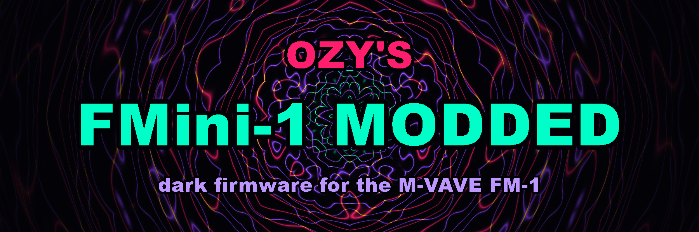
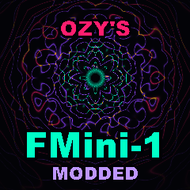

  

  <b>Ozy's FMini-1 Modded</b>: a fork of <a href="https://github.com/ruppert/fmini-1">FMini-1</a> by Guilherme Ruppert,
  the Minimoog Model D emulation for the M-VAVE FM-1, tuned not to tear the audio when you play too many notes, and with a
  dark psychedelic look.

  

## 1. What it is

FMini-1 turns the M-VAVE FM-1 into a three-oscillator, ladder-filter synth modelled on the Minimoog Model D, mono or
polyphonic (12 voices), with 200 presets, onboard effects (chorus, delay, reverb), an arpeggiator, a sequencer, MIDI over
USB and TRS, a web patch editor and a browser emulator. Everything FMini-1 does, this fork does.

This fork changes four things (the details: [CHANGES-OZY.md](CHANGES-OZY.md)):

- **No tearing at full polyphony.** FMini-1 plays every voice on track 1, and the FM-1's second core only ever took
  whole tracks, so at full polyphony one core did all the work and the audio tore.
  - **Voices on both cores.** Each core takes a share of the sounding voices. The share balances itself every 0.7 ms,
    based on which core finished first.
  - **Effects on the second core.** Chorus, delay and reverb run on the second core alongside its voices, one block
    (0.7 ms) behind.
  - **A CPU governor.** It measures what a voice costs and caps the voices at what fits in 80 % of the time. A chord too
    big for the CPU loses its oldest notes (released ones first, never the bass) instead of tearing. "Warning: CPU High"
    now means the audio really ran late; it reads "CPU High: 1 CORE" when the second core is off.
- **Dark psychedelic colours.** The screens are near-black with luminous teal values, ultraviolet labels, blood-magenta
  and dark-gold accents, and glowing conduits where FMini-1 has wooden sides. The power-on picture is a fractal mandala
  of fine glowing lines around an eye. The site and the installer match.
- **The name.** Ozy's FMini-1 Modded, on the power-on screen, the site and the installer.
- **No Bluetooth.** Bluetooth MIDI was tried twice and dropped (see CHANGES-OZY.md).
## 2. Installing

1. Open the installer page in Chrome or Edge: <https://ozymaniacsom.github.io/fmini-1/> (published by this repository's
   "Installer" workflow; see "Publishing" below).
2. Plug the FM-1 into the computer with a USB data cable, press **Install** and keep the cable in until it says Done.
3. **Turn the second core on**, or the voices still run on one core: **MENU > SYSTEM > 2ND CORE > ON**, then restart
   the FM-1. It is FMini-1's BETA setting and off by default. On the few FM-1s whose second core misreads, the firmware
   shows `2ND CORE MISREAD: OFF` and goes on with one core, as before.

To go back: the installer's "Return to official V15", or the original FMini-1 at <https://ruppert.github.io/fmini-1/>.

**Status:** the governor, the effects on the second core and the dark colours (2026-11-04) have not been tested on an FM-1
yet. Report what you find (tearing, notes cut too early, any click or wrong colour) in this repository's issues.

## 3. Building and publishing

- **On GitHub (no local tools):** every push to `main` that touches the firmware, the web pages, the tools or the assets
  runs the **Installer** workflow (`.github/workflows/installer.yml`). It fetches the JieLi toolchain and SDK, builds the
  firmware and publishes the site with the installer. For the site, set **Settings > Pages > Source: GitHub Actions**
  once. The built package is also in each run's artifact.
- **Locally:** see [BUILDING.md](BUILDING.md) (Linux or macOS, the JieLi toolchain and the AC79 SDK), then `./build.sh`.
- The emulator on the site (`/emu/`) is FMini-1's, built from upstream: it has the original colours, one core and no governor.

## 4. Keeping up with FMini-1

This fork follows FMini-1. When FMini-1 has new commits, GitHub shows "This branch is N commits behind
ruppert/fmini-1:main" on the repository page: **Sync fork > Update branch** merges them. The fork's changes are in a few
files (listed in [CHANGES-OZY.md](CHANGES-OZY.md)); if a sync reports a conflict, those are the files to look at.

## 5. Credits

- **Ozy's FMini-1 Modded:** Ozy ([@ozymaniacsom](https://github.com/ozymaniacsom)).
- **[FMini-1](https://github.com/ruppert/fmini-1)** by Guilherme Ruppert: everything the synth is (the engine, the
  filter, the presets, the screens, the site, the editor). Support the original author:
  <https://ko-fi.com/ruppert>.
- **[Felucca](https://github.com/hugelton/Felucca)** by Leo Kuroshita (Hügelton Instruments), which FMini-1 is based on.
- Everyone FMini-1 and Felucca credit: [CREDITS.md](CREDITS.md).

**AI disclaimer:** FMini-1 was developed with the assistance of [Claude](https://claude.ai), an AI model by Anthropic,
and so were this fork's changes.

## 6. Licence and trademarks

GPL-3.0-only, like FMini-1 and Felucca ([LICENSE](LICENSE), [LICENSING.md](LICENSING.md)). This is a modified version of
FMini-1 (see [CHANGES-OZY.md](CHANGES-OZY.md) for what changed and when); its complete source is this repository.

Minimoog and Moog are trademarks of Moog Music Inc.; M-VAVE and FM-1 are trademarks of their owners. This fork is
independent: it is not affiliated with, endorsed by or supported by them, nor by FMini-1's or Felucca's authors.

A fork of <a href="https://github.com/ruppert/fmini-1">FMini-1</a> by Guilherme Ruppert ·
based on <a href="https://github.com/hugelton/Felucca">Felucca</a> by Leo Kuroshita · <a href="LICENSE">GPL-3.0-only</a>

